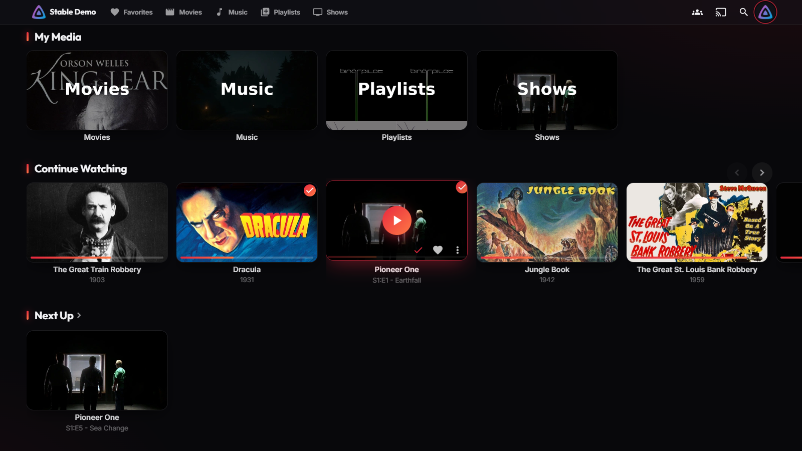
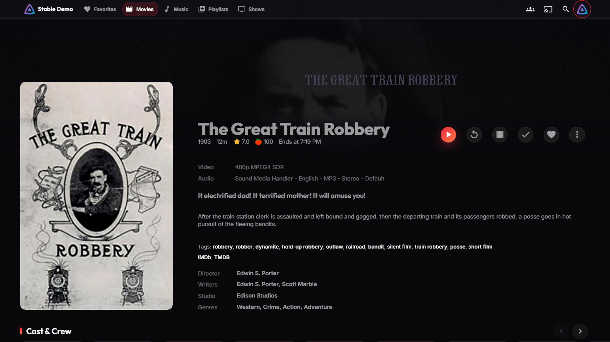
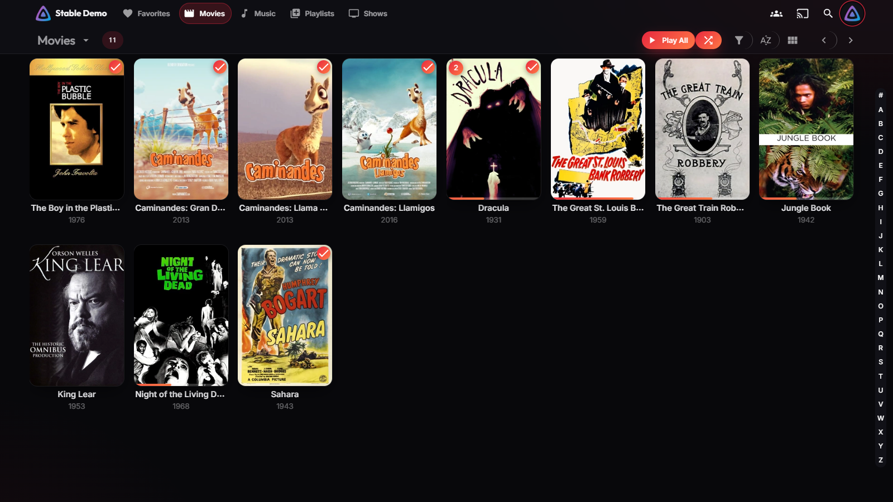
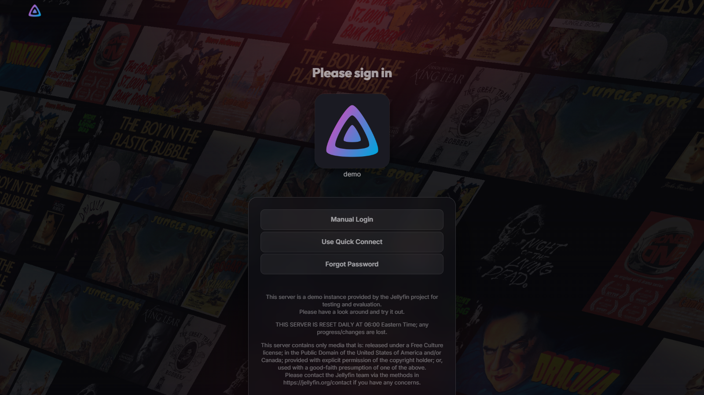
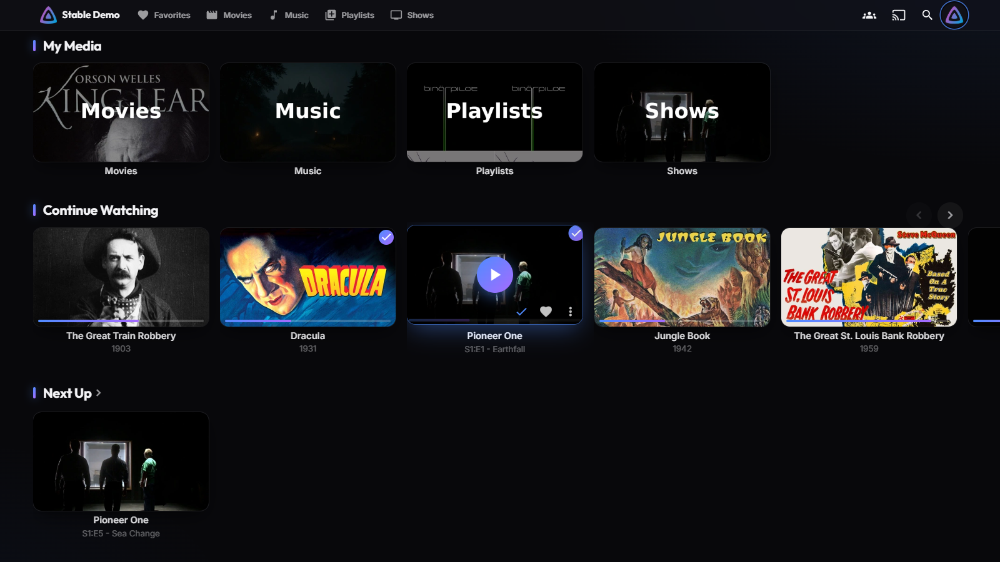
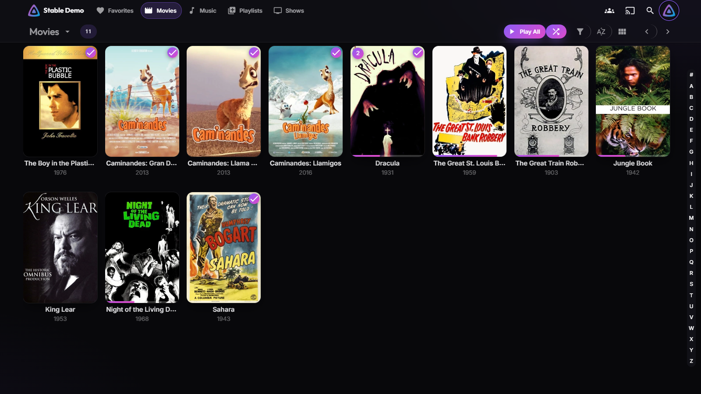

# Domain

A dark, glassy theme for Jellyfin with a cursed-red edge. Frosted header, glowing cards, gradient accents, a cleaner details page and player. It's one CSS file and you don't need a plugin.



| Details | Library |
|---|---|
|  |  |

| Login | Player |
|---|---|
|  |  |

Built and tested against Jellyfin **12.x** web (the modern layout), and it covers the legacy layout's selectors too. Screenshots are from the public Jellyfin demo server.

## Install

**Dashboard → Branding → Custom CSS** (on older versions it's **Dashboard → General → Custom CSS**). Paste this and save:

```css
@import url("https://cdn.jsdelivr.net/gh/Ashen00001/jellyfin-domain@v1.0.0/domain.css");
```

Refresh the page (Ctrl+F5) and you're done. Every user on the server gets it.

If you just want it for yourself, paste the same line into **Settings → Display → Custom CSS** instead.

## Accent presets

Swap `domain.css` for a preset:

| Preset | Accent | Import |
|---|---|---|
| Domain (default) | red → ember | `…@v1.0.0/presets/domain.css` |
| Limitless | blue → violet | `…@v1.0.0/presets/limitless.css` |
| Hollow Purple | violet → magenta | `…@v1.0.0/presets/hollow-purple.css` |
| Toxic | green → lime | `…@v1.0.0/presets/toxic.css` |

```css
@import url("https://cdn.jsdelivr.net/gh/Ashen00001/jellyfin-domain@v1.0.0/presets/limitless.css");
```

| Limitless | Hollow Purple |
|---|---|
|  |  |

## Make your own accent

Add a `:root` block **under** the import:

```css
@import url("https://cdn.jsdelivr.net/gh/Ashen00001/jellyfin-domain@v1.0.0/domain.css");

:root {
  --d-accent: #ff4fa3;        /* main accent */
  --d-accent-rgb: 255 79 163; /* same color as space-separated RGB — used for glows */
  --d-accent-2: #ffb86b;      /* gradient end */
  --d-accent-dark: #c2296f;   /* hover / pressed */
}
```

You can override the other tokens the same way:

| Token | Default | What it does |
|---|---|---|
| `--d-bg` / `--d-bg-rgb` | `#08080b` | page background |
| `--d-paper` / `--d-paper-rgb` | `#111117` | panels, header glass tint |
| `--d-radius` | `14px` | card + panel corner radius |
| `--d-font` | Inter | body font |
| `--d-font-display` | Outfit | titles and headings |

## What it changes

- Frosted-glass header and menus; active library link gets an accent pill
- Cards: rounder corners, lift and glow on hover, gradient play button, gradient progress bars and played badges
- Section titles get an accent tick
- Details page: big display title, backdrop fades into the page, round action buttons with a gradient play button
- Login: centered glass panel with a soft accent glow over the splash backdrop
- Player: gradient OSD, accent seek and volume sliders, and the header goes transparent over the video
- Inputs, selects, checkboxes and dialogs restyled to match. Admin dashboard picks up the palette through Jellyfin's own MUI variables
- Respects `prefers-reduced-motion`

## Notes

- Only the **web UI** is affected (browser, iPad Safari, Jellyfin Media Player, Android app). Native clients like Infuse, Swiftfin and Android TV don't load custom CSS.
- Pin the version (`@v1.0.0`) so an update never changes your server out from under you. `@main` follows the latest, but jsDelivr caches it for up to 12h.
- Something looks off after a Jellyfin update? Open an issue with a screenshot.

## License

MIT
